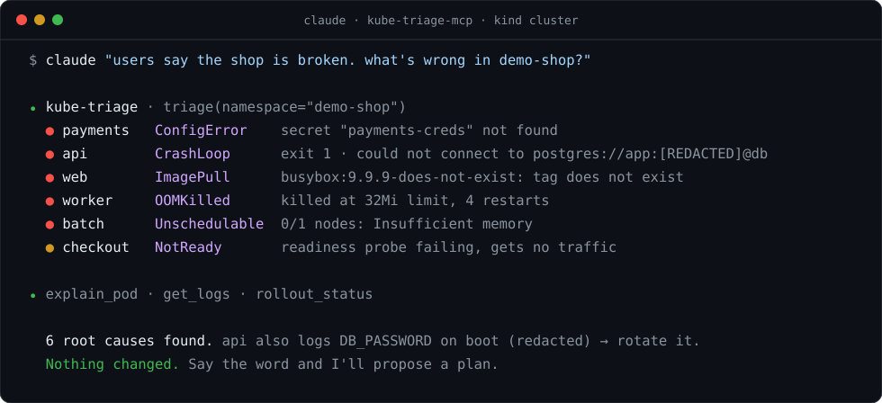
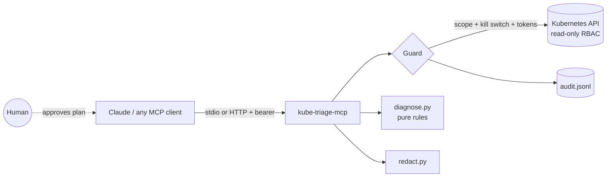

# kube-triage-mcp

**Let an AI agent work a Kubernetes incident with you, without handing it the keys.**

[](https://github.com/qais20/kube-triage-mcp/actions/workflows/ci.yml)


An [MCP](https://modelcontextprotocol.io) server that gives Claude (or any MCP client) the first 20 minutes of an incident: what's broken, why, and what to check next. It is read-only by default, redacts secrets before anything reaches the model, and won't change anything without a human approving a written plan first.



<sub>The run above is real, from Claude Code with this server against a kind cluster running <a href="examples/broken-shop.yaml"><code>examples/broken-shop.yaml</code></a>. The <a href="#real-session">full transcript</a> is below.</sub>

## Why

Every incident starts with the same loop: `get pods`, `describe`, `logs --previous`, `get events`, `rollout history`, and then reading it all to find a cause. An agent can run that loop faster than a person can type it. But if you give a model raw `kubectl`, you've given it your cluster.

This server is the middle ground:

- It turns raw cluster state into **findings**. Each one has a cause, evidence and a next step.
- It holds the model to the **same guardrails you'd put on a new on-call engineer**.

## What it catches

| Failure | How it knows | What it tells you |
|---|---|---|
| CrashLoopBackOff | container state + exit code | the crash logs, with secrets redacted |
| OOMKilled | last termination reason + memory limit | the limit it hit and the restart count |
| Liveness probe kills | `Unhealthy` events | the probe or startup timing is wrong, not the app |
| Image pull failure | pull events | a tag that doesn't exist vs. the registry refusing access |
| Missing Secret / ConfigMap | `CreateContainerConfigError` | which object or key is missing |
| Unschedulable | scheduler condition | not enough CPU/memory, a taint, affinity, or an unbound PVC |
| Running but not ready | readiness probe events | the pod is getting no traffic; check what it depends on |
| Flapping | restarts while running | look at the last crash before it's lost |
| Evicted / node pressure | pod and node conditions | which node, and what kind of pressure |

The diagnosis is plain Python over the API's JSON. There's no model inside the server, so the same cluster state always gives the same findings, and every rule is unit-tested.

## Safety model

The rest of the server is built around this.

| Layer | What it does |
|---|---|
| **Read-only by default** | Write tools refuse until the server is started with `--allow-writes`. |
| **Least-privilege RBAC** | [`deploy/rbac.yaml`](deploy/rbac.yaml) grants no access to Secrets or ConfigMaps. The server can't leak what it can't read. Write access is a separate Role, bound one namespace at a time. |
| **Namespace allow-list** | `--namespaces shop,checkout` scopes every read and write. Anything outside the list is refused. |
| **Redaction** | Logs are scrubbed of passwords, bearer tokens, cloud keys, JWTs, credentials in URLs and private keys before they leave the server. |
| **Propose → approve → execute** | `propose_*` changes nothing. It returns a written plan and a token that is **single-use and expires after 5 minutes**. Only `execute(token)` acts, and it re-checks policy at that moment. |
| **Kill switch** | `touch ~/.kube-triage/STOP` and every write is refused immediately, with no restart. This applies even to plans that were already approved. |
| **Audit log** | Every tool call, plan, refusal and execution is appended to a JSONL log. |
| **Tool annotations** | Tools are marked read-only or destructive, so MCP clients can gate them in their own permission UI. |
| **HTTP auth** | Streamable HTTP mode won't start without a bearer token, compares it in constant time, and has `/healthz` for probes. |

## Tools

| Tool | Kind | Purpose |
|---|---|---|
| `triage(namespace?)` | read | Scans pods and nodes and ranks the findings. **Start here.** |
| `explain_pod(namespace, pod)` | read | Diagnosis, container states, warning events, and the crashed container's last log lines. |
| `get_logs(namespace, pod, container?, previous?, tail_lines?)` | read | Redacted log tail; `previous=true` reads the last crashed instance. |
| `list_events(namespace?, warnings_only?)` | read | Recent events, newest first. |
| `rollout_status(namespace, deployment)` | read | Replica health plus revision history with the image for each revision, to spot a bad release. |
| `propose_restart(namespace, deployment, reason)` | plan | A rolling-restart plan and a token. |
| `propose_scale(namespace, deployment, replicas, reason)` | plan | A scaling plan and a token. Warns when scaling to zero. |
| `execute(token)` | write | Carries out an approved plan. |

There's also an `incident` prompt: give it the symptom ("checkout is 500ing") and it starts a triage session.

## Quick start

**Claude Code**

```bash
claude mcp add kube-triage -- uvx --from git+https://github.com/qais20/kube-triage-mcp kube-triage-mcp --namespaces shop
```

**Claude Desktop** (`claude_desktop_config.json`)

```json
{
  "mcpServers": {
    "kube-triage": {
      "command": "uvx",
      "args": ["--from", "git+https://github.com/qais20/kube-triage-mcp", "kube-triage-mcp", "--namespaces", "shop"]
    }
  }
}
```

It uses your current kubeconfig context; pass `--context` to choose a different one.

**Try it on a cluster that's broken on purpose**

```bash
kind create cluster --name triage-demo
kubectl apply -f examples/broken-shop.yaml   # 6 broken services, 1 healthy
# then ask your agent: "users say the shop is broken. what's wrong in demo-shop?"
```

## Run it in-cluster

To share one server with a team: deploy it once and connect clients over streamable HTTP.

```bash
kubectl create ns kube-triage
kubectl -n kube-triage create secret generic kube-triage --from-literal=token=$(openssl rand -hex 32)
kubectl apply -f deploy/
```

The pod runs as non-root with a read-only root filesystem and all capabilities dropped. Put it behind your ingress with TLS. Clients send `Authorization: Bearer <token>`.

## How it fits together



## Tests

```bash
uv run pytest            # unit + full MCP protocol round trips against a fake cluster
uv run python scripts/e2e.py   # against a real cluster running examples/broken-shop.yaml
```

CI runs both on every push. The e2e job creates a real **kind** cluster, deploys the broken namespace, and fails the build unless the server:

- diagnoses all six failures,
- redacts the leaked password,
- refuses a namespace outside its scope,
- refuses a replayed approval token.

## Real session

<details>
<summary>Claude Code + kube-triage-mcp against <code>demo-shop</code> (unedited)</summary>

Tool calls, in order:

```
triage(namespace="demo-shop")
get_logs(namespace="demo-shop", pod="api-64f7777cb5-59qgg", previous=true, tail_lines=30)
explain_pod(namespace="demo-shop", pod="checkout-754684c849-qvp9c")
rollout_status(namespace="demo-shop", deployment="web")
explain_pod(namespace="demo-shop", pod="api-64f7777cb5-59qgg")
get_logs(namespace="demo-shop", pod="checkout-754684c849-qvp9c", tail_lines=30)
```

Answer:

> demo-shop has six broken workloads. Nothing has been changed yet. Worst first:
>
> 1. **payments**: the pod can't start because the Secret `payments-creds` doesn't exist in the namespace. Fix: create the Secret, or point the pod at the right Secret name.
> 2. **api**: it crashes on boot with exit 1. The log says `FATAL: could not connect to postgres://app:…@db:5432/shop`, so either nothing is answering at `db:5432` or the login is rejected. Fix: check that the `db` Service has a working database behind it, and that the credentials api uses are correct. Separately, api writes `DB_PASSWORD` to its logs at startup (the triage tool hid the value). Remove that line and rotate the password.
> 3. **web**: the image `busybox:9.9.9-does-not-exist` can't be pulled because that tag doesn't exist. There's no older version of the deployment to roll back to. Fix: set the image to a tag that exists.
> 4. **checkout**: the container is running, but nothing answers on port 8080, so the `/ready` check fails and it gets no traffic. It also writes no logs. Fix: make sure the app actually starts and listens on 8080, or correct the port in the readiness check.
> 5. **worker**: it keeps running out of memory against its 32Mi limit and has restarted 4 times. Fix: raise the memory limit to something realistic, or find the leak.
> 6. **batch**: stuck in Pending because it asks for more memory than the single node has free. Fix: lower its memory request or add capacity.
>
> I'd start with payments and api, since checkout probably depends on them. If you want me to make any of these changes, tell me and I'll show you the plan first.

</details>

## License

MIT
